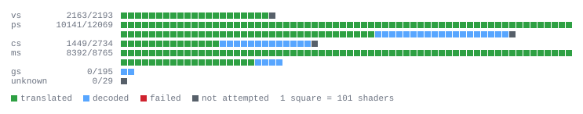

# g6shim

g6shim runs games made for the Xbox One and Xbox Series X|S consoles on Windows PCs, without emulation. A console game's executable is an x64 PE file whose code already runs on a PC; what a PC lacks are the console's system DLLs. g6shim builds replacements with the same file names, placed next to the game, and implements them one function at a time.

## How it works

1. `g6shim-scan` reads every executable and DLL in a game folder and lists the imported functions that neither Windows nor the game itself provides.
2. `g6shim-stubgen` turns each missing DLL into a project in `hle/`: a `.def` file with one export per function, each a logging stub or a forwarder to the PC's own DLL.
3. Stubs are replaced by real implementations one by one. The `.def` files record what is done.
4. `g6shim-relink` patches a copy of the executable when an import must be routed through g6shim, for DLLs Windows always loads itself.
5. The replacement DLLs are built and copied into the game folder, and `g6shim-run` starts the game under a minimal debugger that shows the next missing function.

## Components

| Path | What it is |
|---|---|
| `src/core/` | Library shared by the tools: PE reader, game-folder inventory, `.def` handling, relinking |
| `src/shader/` | Shader translator for the Series GPU: GFX10 decoding, containers, SSA, lane structurisation, resource tracking, DXIL emission |
| `src/tools/` | `g6shim-scan`, `g6shim-stubgen`, `g6shim-relink`, `g6shim-run` |
| `runtime/` | `g6shim_runtime.dll`, loaded by every replacement DLL: logging, stub macro, the shared game window |
| `hle/<dll>/` | One replacement DLL per folder: kernel services, graphics (`d3d11_x`), audio, WinRT activation and forwarders |
| `winrt/` | Library behind WinRT activation: the object kit (probes, events, collections, async objects, package activation) and stand-ins for console classes, grouped by namespace |
| `tests/` | Unit tests and an end-to-end test that runs the whole pipeline on a fake game |
| `tools/` | Convention, ledger, coverage and progress scripts, git hooks |
| `docs/` | [Running games](docs/running.md), observed binary layouts per DLL ([abi](docs/abi/)), [developer notes](docs/dev/hle.md) and the [technical-debt ledger](docs/dev/debt/README.md) |

## Progress

**Target: the Series title 7952987A.** It starts, opens all its archives and renders about 12 frames per second up to its account picker. Next milestone: **an offline user, then the main menu**.

| | Area | Progress |
|:-:|---|---|
| ✅ | Loading | `▰▰▰▰▰▰▰▰▰▰ 100 %` |
| ✅ | Memory · `xmem` | `▰▰▰▰▰▰▰▰▰▱ 95 %` |
| ✅ | Audio · `AcpHal` `xapu` `chad` | `▰▰▰▰▰▰▰▰▱▱ 80 %` |
| ✅ | Textures · `xg_xs` | `▰▰▰▰▰▰▰▰▱▱ 85 %` |
| ✅ | Storage · `XCRDAPI` | `▰▰▰▰▰▰▰▰▱▱ 85 %` |
| 🔨 | Shaders | `▰▰▰▰▰▰▰▱▱▱ 75 %` |
| 🔨 | Graphics · `d3d12_xs` | `▰▰▰▰▰▰▰▱▱▱ 70 %` |
| 🔨 | Runtime services | `▰▰▰▱▱▱▱▱▱▱ 35 %` |
| 🔨 | Ray tracing | `▰▰▰▰▱▱▱▱▱▱ 40 %` |

✅ works · 🔨 in progress · ⬜ not started

<details>
<summary>What is implemented and what is left</summary>

| Area | Implemented | Left |
|---|---|---|
| Loading | The executable and its DLLs load through the Windows loader; static initialisation runs | – |
| Memory · `xmem` | All functions: the title's allocation hooks, address ranges, 64 KiB physical pages, budgets | GPU-side page mapping |
| Audio · `AcpHal` `xapu` `chad` | Coprocessor queues, APU memory, shape contexts, XMA2 decoding, Opus decoding, DSP queues | DSP transforms, SHAPE units other than XMA |
| Textures · `xg_xs` | Tiled layouts of the Series GPU, texture computer, tiled and linear copies | XOR and MSAA addressing, metadata planes |
| Storage · `XCRDAPI` | DirectStorage factory, files, queues and status arrays; zlib and BCPack decompression | BCPack needs the format tables (`-DG6SHIM_FETCH_BCPACK_TABLES=ON` or `G6SHIM_BCPACK_TABLES`); some interface slots |
| Shaders | Decoding, containers, SSA, lane structurisation, resource and I/O tracking, DXIL emission for vertex, pixel, compute and mesh shaders | Checking the whole shader set; merged geometry stages |
| Graphics · `d3d12_xs` | Device creation, DXGI adapter, fences, heaps and resources, descriptor heaps, root signatures, samplers, queries, frame pacing; the host D3D12 device, host descriptor heaps, copies of title buffers, write tracking, texture uploads; command queues and lists, draws, dispatches, mesh and indirect execution, host pipelines from translated shaders with disk caches | Presentation to a window, queries, real-GPU checks |
| Runtime services | The PC's own XGameRuntime starts; the package drive `G:\` for titles that call Windows file functions directly | Persistent storage drive, saves, input and lifecycle where the title needs them |
| Ray tracing | Acceleration-structure builder in the console's BVH4 layout: compute-shader builds, refits, copies and sizes, checked against a CPU reference | Calls from the command list; procedural geometry |

</details>

<!-- progress:begin -->
Each square is one function: green implemented, blue forwarded, amber stubbed, grey missing; the replacement DLL map counts forwarded exports after the squares; in the shader maps green is translated, blue decoded, red failed and grey not attempted.

### 7952987A




39/39 functions implemented, 0 forwarded, 0 stubbed, 0 missing; shaders: 22168/25985 translated, 3785 decoded.


<!-- progress:end -->

## Build

Windows with Visual Studio 2022 or newer (C++ desktop workload) and CMake 3.25 or newer. The first configure downloads libopus 1.6.1 for `xapu.dll`; offline, point `FETCHCONTENT_SOURCE_DIR_OPUS` at an unpacked copy.

```bat
cmake --preset release
cmake --build --preset release
ctest --preset release
```

Tools and DLLs land in `build\bin\Release\`. The `debug` presets build the Debug configuration.

## Usage

See [docs/running.md](docs/running.md) for the workflow, every tool option and every environment variable. Contributors start with [CONTRIBUTING.md](CONTRIBUTING.md).

## Legal

- g6shim is not affiliated with or endorsed by any platform holder or game publisher.
- All trademarks belong to their owners.
- This repository contains no game files, keys or decryption code.
- It does not explain or help with obtaining, dumping or decrypting games.
- Use it only with games you own.

## Licence

[GPL-3.0-or-later](LICENSE).
